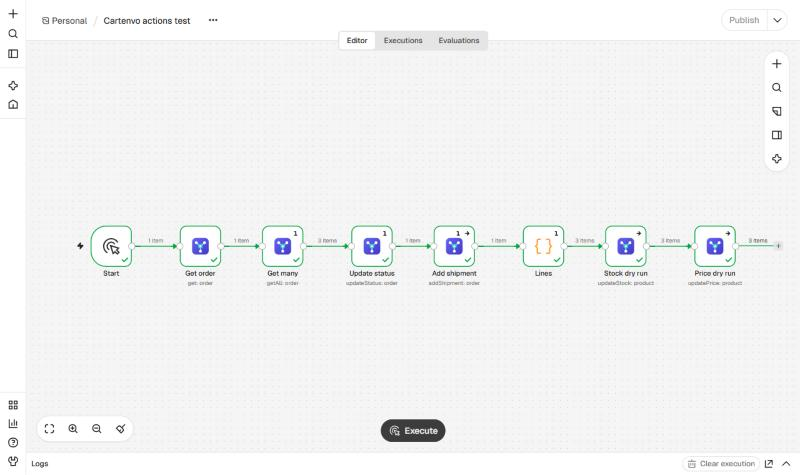

# n8n-nodes-cartenvo

n8n nodes for **nopCommerce** stores that run the free
[Cartenvo Integration Hub](https://cartenvo.com/plugins/integration-hub/docs) plugin
(nopCommerce 4.80, 4.90 and 5.00).

- **Cartenvo Integration Hub Trigger** starts a workflow the moment the store sends an event: a new or paid order, a
  shipment, a stock or price change, a new customer. It registers its own webhook in the store when the workflow is
  activated, removes it when it's deactivated, and checks every delivery's signature.
- **Cartenvo Integration Hub** reads orders, changes their status, adds shipments with tracking, and sets stock and
  prices by SKU, up to 1,000 lines a call.

[Installation](#installation) · [Credentials](#credentials) · [Trigger](#trigger) · [Actions](#actions) ·
[Example workflows](#example-workflows) · [Compatibility](#compatibility)



## Installation

In n8n, open **Settings → Community nodes → Install**, enter `n8n-nodes-cartenvo` and confirm. The
[n8n guide](https://docs.n8n.io/integrations/community-nodes/installation/) covers self-hosted installs too.

On n8n Cloud, community nodes can be installed once n8n has verified them; until then, the
[guide](https://cartenvo.com/plugins/integration-hub/docs/automation/n8n#without-the-cartenvo-nodes)
shows the same workflows with the built-in Webhook and HTTP Request nodes.

The store needs the Integration Hub plugin installed (**Configuration → Local plugins**, or from the nopCommerce
marketplace).

## Credentials

1. In the store's admin, open **Configuration → Integration Hub → API keys** and click **Add key**.
2. Name it ("n8n"), and tick the scopes the workflows need:

   | For | Scopes |
   |---|---|
   | The trigger | `webhooks:manage` |
   | Get and Get Many orders | `orders:read` |
   | Update Status, Add Shipment, Add Note | `orders:write` |
   | Get and Get Many customers | `customers:read` |
   | Update Roles (needs Integration Hub Pro) | `customers:write` |
   | Set External Reference | `references:write` |
   | Update Stock | `stock:write` |
   | Update Price | `prices:write` |

3. Save and copy the key (it starts with `cih_` and is shown once).
4. In n8n, add a **Cartenvo Integration Hub API** credential with the store's address (such as
   `https://shop.example.com`) and the key. n8n checks it straight away.

The store accepts keys only over `https://`. **Ignore SSL Issues** is for test stores with a self-made certificate.

## Trigger

Pick the events (or **All Events**) and activate the workflow. Each delivery becomes one item: the event's envelope
with the order, shipment, product, stock line or customer under `data`, in the shapes the
[webhook guide](https://cartenvo.com/plugins/integration-hub/docs/webhooks)
documents.

```json
{
  "id": "evt_3f9c2a7d0b1e4c55a1d2e3f4a5b6c7d8",
  "type": "order.paid",
  "schemaVersion": 1,
  "occurredOnUtc": "2026-11-02T10:15:00.000Z",
  "store": { "id": 1, "name": "Your store", "url": "https://shop.example.com/" },
  "data": { "id": 1042, "number": "1042", "status": "Processing", "totals": { "total": 132 }, "items": [ … ] },
  "context": null
}
```

- **Payload: Thin** sends only `{"object", "id", "adminUrl"}` under `data`, for workflows that read the rest with the action node.
- **Options → Include Headers** adds `delivery` (event ID, delivery ID, attempt) to each item. The event ID stays the
  same on retries, so it's the one to drop repeats by.
- **Options → Check Signature** (on by default) refuses deliveries that aren't signed with this webhook's secret.

The store must be able to reach n8n. n8n's test URL (`/webhook-test/…`) works only while you click
**Listen for test event**; the store's own **Send test** button (in the webhook's page in admin) is the quickest way to
send one. A store with **Block private networks** on (the default) won't send to an n8n on `localhost` or a private
address.

## Actions

| Resource | Operation | What it does |
|---|---|---|
| Order | **Get** | One order with its items, addresses, totals and external references |
| Order | **Get Many** | Orders oldest or newest first, filtered by order number, status, payment or shipping status, dates, or an ERP number |
| Order | **Update Status** | Order status (Pending, Processing, Complete, Cancelled) and payment status (Paid, Refunded, Voided), through nopCommerce's own rules and emails |
| Order | **Add Shipment** | Some items (by SKU or order item) or everything left, with a tracking number, shipped and delivered at once if you like |
| Order | **Add Note** | A note on the order, for staff, or shown to the customer and emailed to them |
| Order | **Set External Reference** | The order's number in another system (such as `odoo` → `SO0042`), found again with Get Many; empty removes it |
| Customer | **Get** | One registered customer with their roles, addresses and external references |
| Customer | **Get Many** | Registered customers oldest or newest first, by email, date or an ERP number |
| Customer | **Set External Reference** | The customer's number in another system; empty removes it |
| Customer | **Update Roles** | Add and remove customer roles, such as a price group, with a dry run. Needs [Integration Hub Pro](https://cartenvo.com/plugins/integration-hub-pro) in the store |
| Product | **Update Stock** | Set or adjust stock by SKU or product ID, per warehouse and attribute combination, kept in stock history |
| Product | **Update Price** | Set price, old price and cost by SKU or product ID |
| Product | **Set External Reference** | The product's code in another system; empty removes it |

- **Stock and prices are sent in bulk:** each input item is one line, and up to 1,000 lines go in one call. Each
  output item says what happened to its line (`updated`, `unchanged` or `failed`, with old and new values).
- **Dry Run** checks every line and reports what would change, without changing anything. Useful the first time a
  spreadsheet or ERP export is used.
- Writes carry an idempotency key, so n8n's **Retry On Fail** doesn't apply a change twice.
- With **On Error: Continue**, failed lines and orders come out as items with `error` instead of stopping the
  workflow.
- **Update Roles** names roles by system name or name, as in **Customers → Customer roles**. System roles and roles
  that may open the admin area can't be changed from n8n. Without Pro in the store the call is refused; the node itself
  is free and checks no licence.

## Example workflows

The [`examples/`](examples/) folder has workflows to import (**Workflows → Import from file**):

- **New order → Google Sheets row:** each paid order becomes a row with its number, customer, total and items.
- **New order → Slack message.**
- **Stock from a sheet:** reads SKU and quantity from Google Sheets every hour and sets stock in one call, with a dry
  run first.

## Compatibility

- Tested with n8n 2.45.
- The Integration Hub plugin release 2 or later (it adds the API these nodes use). Get Many's order number filter
  and newest-first sort need release 5; Update Roles needs release 6 and Integration Hub Pro release 4.
- nopCommerce 4.80, 4.90 and 5.00.

## Resources

- [Integration Hub API guide](https://cartenvo.com/plugins/integration-hub/docs/api)
- [Webhook guide](https://cartenvo.com/plugins/integration-hub/docs/webhooks)
- [n8n community nodes](https://docs.n8n.io/integrations/#community-nodes)

## Licence

MIT. The Integration Hub plugin is free to use; its own licence is at https://cartenvo.com/plugins/integration-hub/license.
